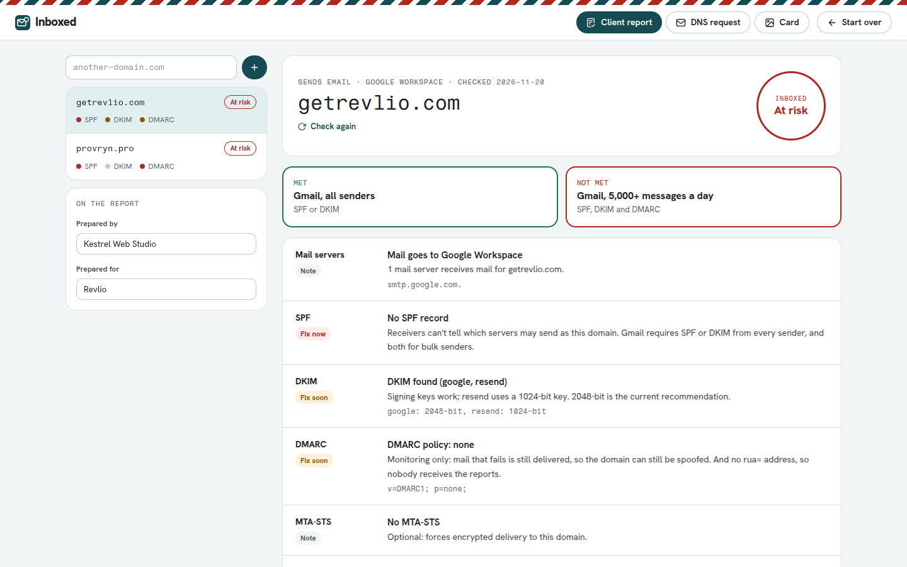
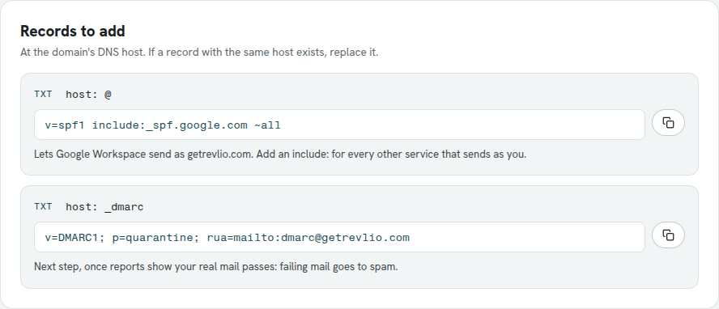
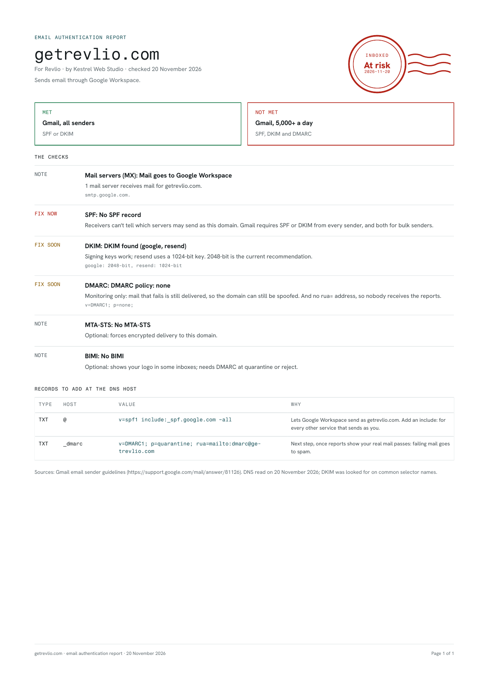
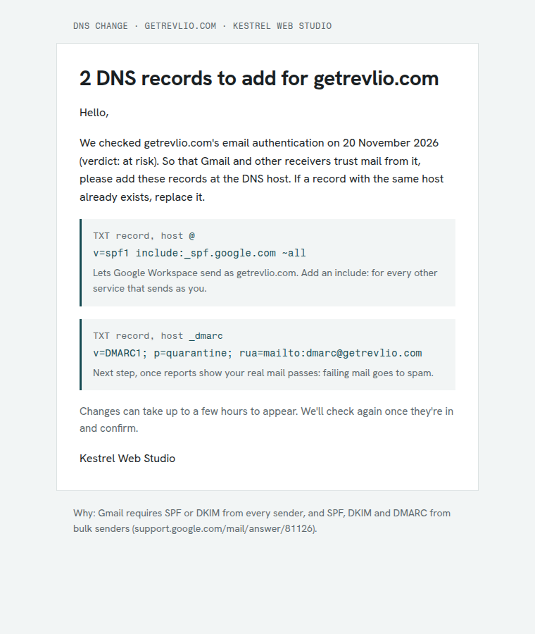
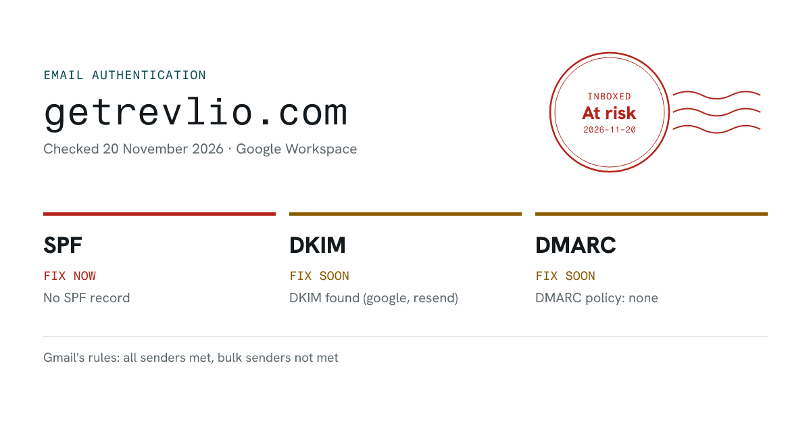

# Inboxed

**Will this domain's email land in the inbox?** Type one or more domains. Inboxed reads their SPF, DKIM and DMARC
records from public DNS, checks them against Gmail's sender rules (and GOV.UK's guidance for domains that don't send
email), and writes three things:

- a client report (PDF) with the verdict and the exact records to add
- a DNS change request (email) for whoever manages DNS
- a status card (PNG)

Built with [Hyper Elements](https://github.com/hyper-elements/hyper-elements) for the Hyper Elements Template Challenge.

**Live:** https://inboxed.rohitkashyapmrt.workers.dev



## Why this exists

[Gmail's email sender guidelines](https://support.google.com/mail/answer/81126):

> We require that you set up these email authentication methods for your domain:
> **All senders: SPF or DKIM. Bulk senders: SPF, DKIM, and DMARC.**
> Messages that aren't authenticated with these methods might be marked as spam or rejected with a 5.7.26 error.

People find out from bounces. On r/squarespace (April 2025), under
["550 5.7.26 Unauthenticated email errors when sending emails to GMAIL"](https://old.reddit.com/r/squarespace/comments/1k11vmb/):
"This entire thing is a total disaster!", and a reply: "Same issue here, just noticed when I tried to email a client
today. No idea if I've been losing the emails they've been sending me over the last week as well."

Domains that never send email matter too: anyone can send mail that claims to be from them. GOV.UK's
[Protect domains that do not send email](https://www.gov.uk/guidance/protect-domains-that-dont-send-email) gives the
four records (`v=spf1 -all`, DMARC `p=reject`, an empty DKIM key, a null MX).

**A real example (20 Nov 2026).** Two of the author's own domains:

| Domain | Finding | First fix |
|---|---|---|
| getrevlio.com (Google Workspace) | No SPF record; DKIM on `google` (2048-bit) and `resend` (1024-bit); DMARC `p=none` with no reports | `v=spf1 include:_spf.google.com ~all` |
| provryn.pro (sends no email) | No SPF, no DMARC: can be spoofed | GOV.UK's four records |



## How it works

| Step | What happens |
|---|---|
| **Type the domains** | One or many. The browser asks Google Public DNS over HTTPS (`dns.google`, Cloudflare as fallback); both allow cross-origin requests. |
| **Read the verdict** | Each check in plain words, and whether Gmail's rule for all senders and for bulk senders is met. A domain with no MX, no DKIM and no sending SPF is judged as a domain that doesn't send. |
| **Copy the records** | The exact records to add, worked out from the mail provider seen in the MX records (Google Workspace, Microsoft 365, Fastmail, Proton, Zoho), each with the reason. |
| **Send the paperwork** | Preview and download the report, the DNS request and the card. |

What it checks:

- **SPF:** exactly one record; `-all`/`~all` (not `+all`, `?all` or nothing); the DNS-lookup count with includes and
  redirects followed, against the limit of 10; the mail provider's include.
- **DKIM:** the provider's selector plus 20+ common ones (`google`, `selector1/2`, `k1`, `s1`, `resend`, …), and the
  key size. A selector can be any name, so "not found" is a warning, not a failure; you can add selectors and check
  again.
- **DMARC:** the policy, `pct`, and whether `rua` sends reports anywhere.
- **MX, MTA-STS, BIMI:** the provider, and two optional extras.

| Client report | DNS request | Card |
|---|---|---|
|  |  |  |

A domain that doesn't send: [media/not-sending.png](media/not-sending.png). The landing page (7 sections with an
FAQ): [media/landing.png](media/landing.png). On a phone: [media/mobile.png](media/mobile.png).

## How Hyper Elements is used

The three outputs are **Hyper Elements templates** in `templates/`. The app renders them in the browser
(`src/lib/render-route.ts`, so the site runs on Cloudflare with no render server), and the CLI renders the same files.

- **Typed fields with rules** (`templates/_shared/doc.tsx`): the domain must look like a domain, each check's result
  is one of `pass / warn / fail / info`, a record is `TXT` or `MX`, and there are at most 8 records. A value outside
  the rules stops the render with the field and the reason (the API answers 422).
- **`<Document>` + `renderPdf()`** for the report: the postmark seal (an `Svg` of rings and cancellation waves with the
  verdict laid over it in a `Layer`), the two Gmail rules, the checks, and the records `Table`. The layout check
  caught the seal overflowing its column while we built it.
- **`<Email>`** for the DNS request, each record in mono on its own block, with lint (`lang`, `contrast`,
  `link-text`), the email client checks and preview text required.
- **`<Canvas>` + `renderImage()`** for the 1200 × 630 card, with `image/overflow`, `image/glyph` and `image/fit`
  required; the domain shrinks to fit.
- **Values files + CLI:** `npm run reports` turns `docs/getrevlio.json` into values files with `hyper-elements
  design new`, then renders all three with `hyper-elements render`.

## Run it

Needs Node 22.6+.

```bash
npm install
npm run dev            # http://localhost:3000 (landing) and /check (the dashboard)
```

```bash
npm test               # the two real domains, SPF/DMARC edge cases, include-following, domain cleanup (6 tests)
npm run check          # check the three templates with their example
npm run reports        # docs/getrevlio.json → out/docs/ (report PDF, request email, card PNG)
npm run sample         # re-read the two domains' DNS and rebuild the sample
npm run preview:email  # the email as each email client draws it
npm run build && npx wrangler dev   # the static site, served the way Cloudflare does
```

## Project layout

```
templates/_shared/mail.ts     gathering DNS (any resolver), the checks, providers, the records to add (no imports)
templates/_shared/doc.tsx     fields, the postal look, the postmark seal
templates/_shared/example.ts  the sample: getrevlio.com on 20 Nov 2026 (generated by scripts/sample.ts)
templates/report.tsx          <Document>: the client report
templates/request.tsx         <Email>: the DNS change request
templates/card.tsx            <Canvas>: the status card
src/lib/dns.ts                DNS over HTTPS (dns.google, Cloudflare fallback), the frozen sample
src/components/Postroom.tsx   the dashboard: domains, checks, records, outputs
src/app/page.tsx              the landing page
public/samples/               the two domains' DNS answers, frozen 20 Nov 2026
tests/                        mail tests
```

## Sample data

`public/samples/domains-2026-11-20.json` holds the DNS answers for getrevlio.com and provryn.pro on 20 November 2026,
read through dns.google. Both domains belong to this series' author. "Kestrel Web Studio", who prepares the sample
report, is made up. Inboxed is not affiliated with Google, GOV.UK or any provider named.

## License

MIT for the code. Fonts: Hanken Grotesk and Fragment Mono, SIL Open Font License 1.1 (`fonts/OFL-*.txt`).
